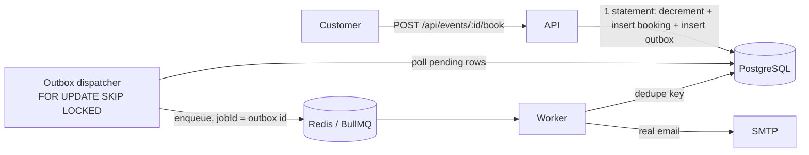

# Architecture Context

## Stack
| Layer | Technology | Role |
|---|---|---|
| Runtime | Node.js 20, CommonJS JavaScript | API + worker processes (TypeScript migration is out of scope) |
| HTTP | Express 4 | Routing, middleware |
| Database | PostgreSQL 15+ via `pg` (raw parameterized SQL, NO ORM) | Source of truth. Raw SQL is required so the booking is one atomic statement |
| Queue | Redis + BullMQ | Durable job execution, retries, rate limiting |
| Email | Nodemailer + SMTP (Brevo or Gmail app password; Mailtrap for load tests) | Real delivery, only called from the worker |
| Validation / config | zod | Request bodies, query params, env at boot |
| Auth | jsonwebtoken + bcryptjs | Stateless JWT carrying `sub` and `role` |
| Logging | pino + request id | Structured logs |
| Tests | Vitest + Supertest, real Postgres/Redis via docker-compose | Integration + concurrency tests |
| Load test | k6 | Reproducible scenarios, raw JSON summaries |
| Hosting | Render (web service, background worker, Postgres, Key Value/Redis) | Public deployment |

## System Boundaries
- `src/app.js` — builds the Express app (no `listen`), so tests can import it.
- `src/server.js` — process entry for the API (listen, graceful shutdown).
- `src/worker.js` — process entry for the BullMQ worker + outbox dispatcher. Separate process from the API.
- `src/config/` — env parsing/validation. The only place `process.env` is read.
- `src/db/` — pool, `migrations/*.sql` (forward-only, numbered), migration runner.
- `src/modules/auth|events|bookings/` — each has `routes.js` (HTTP only), `service.js` (rules), `repo.js` (ALL SQL for that module).
- `src/middleware/` — requestId, authenticate, requireRole, validate, rateLimit, errorHandler.
- `src/outbox/` — dispatcher that moves outbox rows to BullMQ.
- `src/queue/` — queue/worker definitions and job handlers.
- `src/mail/` — transport + templates. Imported only by `src/queue/` handlers.
- `src/naive/` — V1 baseline booking route. Isolated, env-gated (`ENABLE_NAIVE=true`), imports nothing from V2 booking code.
- `tests/unit|integration|concurrency/`, `loadtest/` (scripts + `results/`), `docs/`.

## Storage Model
- **PostgreSQL** holds everything that must survive: users, events, bookings, outbox, notification log. Inventory lives ONLY here.
- **Redis** holds transient job state only (BullMQ). Losing Redis must not lose notification intent, because intent is in the outbox table.
- No blob storage, no caching layer for inventory. (A short-TTL cache for `GET /events` is an optional optimization measured in performance-plan.md.)

## Data Model
- `users(id uuid pk, name, email unique, password_hash, role check in ('ORGANIZER','CUSTOMER'), created_at)`
- `events(id uuid pk, organizer_id fk, title, description, venue, event_date timestamptz, price_cents int>=0, total_tickets int>0, available_tickets int, version int default 1, updated_at)` with `CHECK (available_tickets >= 0 AND available_tickets <= total_tickets)`
- `bookings(id uuid pk, event_id fk, customer_id fk, tickets_count int 1..10, total_cents int, idempotency_key text, request_hash text, status default 'CONFIRMED', created_at)` with `UNIQUE (customer_id, idempotency_key)`; indexes on `(event_id)`, `(customer_id, created_at desc)`
- `outbox_events(id bigserial pk, event_type, payload jsonb, created_at, processed_at null, attempts int default 0)` with partial index on `processed_at IS NULL`
- `notification_log(dedupe_key text pk, kind, recipient, sent_at)` — guards against double-sending when a job is retried after SMTP already succeeded

## Key Flows

**Booking (V2):** (1) fast-path lookup of `(customer_id, idempotency_key)`; (2) ONE statement: `WITH upd AS (UPDATE events SET available_tickets = available_tickets - $n WHERE id=$e AND available_tickets >= $n AND event_date > now() RETURNING ...), ins AS (INSERT INTO bookings ... SELECT FROM upd RETURNING ...) INSERT INTO outbox_events ... SELECT FROM ins`; (3) zero rows → distinguish 404 vs 409 with a follow-up read; (4) unique violation `23505` on the idempotency key means a concurrent twin won: the single statement rolled back entirely (including the decrement), so re-read and return the existing booking with 200.
**Event update:** `PATCH` runs one transaction: lock the event row, validate ownership and `total_tickets >= sold`, update, bump `version`, insert `event_updated` outbox row containing the changed fields. Customer-visible fields only: title, description, venue, event_date, price.
**Worker:** `booking_confirmed` → load booking/user/event → send email. `event_updated` → page through distinct confirmed customers in batches of 100 → enqueue per-recipient jobs with `jobId = eu:{eventId}:{version}:{customerId}` → send. Rate limit: `EMAIL_RATE_PER_SEC`. Retries: 5 attempts, exponential backoff. Dead jobs stay in BullMQ failed set and are re-driven by `npm run jobs:retry-failed`.

## Auth and Access Model
- Public: register, login, GET events, health.
- JWT (12h) with `sub` and `role`; `requireRole` checks the token without a DB hit.
- Ownership is enforced inside SQL (`WHERE id=$1 AND organizer_id=$2`), never by fetch-then-compare in application code.
- Organizer self-registration requires `ORGANIZER_SIGNUP_CODE` (env var, shared in README for graders). CUSTOMER needs no code. Wrong/missing code for ORGANIZER → 403.

## Invariants
1. `available_tickets` is only ever changed by a conditional UPDATE (`... WHERE available_tickets >= n`) or by the locked event-update transaction; never by read-modify-write in application code (V1 in `src/naive/` is the sole exception).
2. The inventory decrement, the booking row and its outbox row commit atomically (same statement/transaction).
3. HTTP request handlers never call SMTP or wait on Redis. If Redis is down, bookings still succeed.
4. Every protected route runs in this order: authenticate → authorize role → validate input → ownership/SQL guard. No mutation before all four.
5. Background handlers are idempotent: deterministic `jobId`, plus `notification_log.dedupe_key` checked before sending.
6. `src/naive/` is never imported by non-naive code and is unreachable unless `ENABLE_NAIVE=true`. It is never enabled in the final deployment.
7. No performance number is written into any doc unless a raw result file in `loadtest/results/` backs it.
8. Secrets exist only as environment variables; `.env` is git-ignored; `.env.example` has no real values.
9. Migrations are forward-only; an applied migration file is never edited (add a new one).
